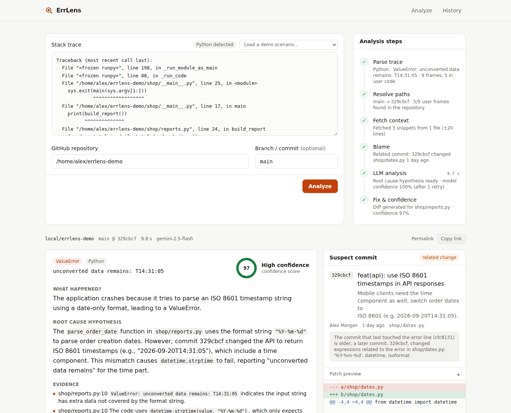

# ErrLens

**From stack trace to root cause.** Paste a stack trace and a GitHub repository link. ErrLens parses the trace, pulls the related code and recent commits from GitHub, and has an LLM analyze them. You get back:

- a plain-language explanation of the error,
- a root cause hypothesis with evidence,
- the suspect commit that most likely introduced the bug,
- a confidence score with the reasons behind it,
- a single-file fix as a diff that applies cleanly with `git apply`.

Every step of the analysis streams live to the UI.



**Supported:** Python and JavaScript (Node/V8) stack traces, public GitHub repositories and private ones reachable with a token, Claude or Gemini as the LLM.

**Not supported (yet):** minified/bundled JavaScript without source maps, fixes spanning multiple files, hosts other than GitHub, verifying fixes by executing code.

## Why

The line a stack trace points to is often not where the bug is. The cause is frequently a recent commit somewhere else: an API field that was renamed, a function that started returning `null`, a date format that changed. ErrLens looks at the trace and at the history of the code around it, so it can point to that commit.

## How it works

The pipeline is a single async generator (`backend/app/pipeline.py`). Each step emits an event, and the last one carries the full result.

1. **parse:** Detects the language, the exception type and message, and all frames (innermost first), and separates user code from library code. Handles chained exceptions and warns about minified traces.
2. **resolve_paths:** Resolves the ref to a commit SHA, fetches the repository tree and maps absolute trace paths (`/home/deploy/app/user.py`) to repository paths (`app/user.py`) by longest suffix match.
3. **fetch_context:** Fetches ±20-line snippets for the first 3 user frames. If the source line in the trace does not match the repository, it warns and lowers the confidence.
4. **blame:** Blames the lines around each error line. It then runs a **related-commit search**: if the error lines have not changed since then, it scores the patches of later commits in the same language against the identifiers and string literals on the error lines (for example `'%Y-%m-%d'`). This finds the cause when the line the trace points to is not the one that changed.
5. **analyze:** Calls the LLM with a forced tool call. The output is validated in two layers: first the schema, then the semantics (the file and line range must be inside the shown snippet, the diff must build, and the code must pass a Python/JS syntax check). On failure, the error goes back to the model and it gets one retry. If it still fails, the result is returned without a fix.
6. **build_fix:** Turns the edit into a unified diff with `difflib`; the LLM never writes the diff itself. The confidence score is `0.6 × LLM confidence + 0.4 × average of signals`. The signals are: user frame resolved, change within the last 14 days, error type matches the line, fix validated, trace lines match the commit.
7. **done:** Saves the result to SQLite. The cache key is a hash of the normalized trace, the repository and the SHA, so an identical request returns without calling the LLM.

The pipeline only stops on parse errors and user input errors (invalid URL, repository or ref not found). If any other step fails, it is marked `error` or `skipped` and the analysis continues with what it has.

## Quick start

Requirements: Python 3.10+, Node.js 20+, git.

**Windows, one click:** run `setup.bat`. It creates `backend\.venv`, installs the Python and npm packages and creates `backend\.env`. Then use `run-tests.bat`, `start-backend.bat` and `start-frontend.bat`.

**Any OS, manually:**

```bash
# 1) Backend
cd backend
python -m venv .venv && source .venv/bin/activate   # Windows: .venv\Scripts\activate
pip install -r requirements-dev.txt
cp .env.example .env        # only if .env does not exist yet; then add your keys
uvicorn app.main:app --reload --port 8000

# 2) Frontend (in a second terminal)
cd frontend
npm install
cp .env.example .env.local  # NEXT_PUBLIC_API_URL=http://localhost:8000
npm run dev                 # http://localhost:3000
```

No keys yet? Two options:

- Start the backend with `ERRLENS_FIXTURE_MODE=true`. Every request streams a sample result with realistic delays.
- Click **"show a sample result"** on the home page. It renders a sample result without any backend.

## Configuration

All settings are environment variables, read from `backend/.env`. See `backend/.env.example` for the full list.

| Variable | Default | Description |
|---|---|---|
| `LLM_PROVIDER` | `auto` | `auto`, `anthropic` or `gemini`. With `auto`, Claude is used if its key is set, otherwise Gemini. |
| `ANTHROPIC_API_KEY` | | Claude API key |
| `ERRLENS_MODEL` | `claude-sonnet-5` | Claude model |
| `GEMINI_API_KEY` | | Google Gemini API key ([free tier](https://aistudio.google.com/apikey) works) |
| `GEMINI_MODEL` | `gemini-2.5-flash` | Gemini model |
| `GITHUB_TOKEN` | | Personal access token. Required for blame; raises the rate limit from 60 to 5000 requests/hour. `Contents: read` is enough. |
| `ERRLENS_OUTPUT_LANGUAGE` | `English` | Language the model writes its explanations in |
| `CORS_ORIGINS` | `http://localhost:3000` | Comma-separated allowed origins. Add `*.vercel.app` for Vercel previews. |
| `ERRLENS_ALLOW_LOCAL_REPOS` | `false` | Accept a local git repository path as the repository (offline rehearsals). Keep it off in production. |
| `ERRLENS_FIXTURE_MODE` | `false` | Stream a sample result instead of running an analysis |

On the Gemini free tier, the client waits for the suggested `retryDelay` and retries when it hits the per-minute limit.

## Demo repository

The demo repository is a small user/order service (Python) plus a Node script, with three bugs, each introduced by its own realistic commit. It must live in a separate GitHub repository, because ErrLens analyzes it like any other repository. Commit dates are relative to the day you build it, so the "changed in the last 14 days" signal still works on demo day. **Build it a few days before a demo** and push it:

```bash
python demo/build_demo_repo.py ../errlens-demo
cd ../errlens-demo
git remote add origin https://github.com/<user>/errlens-demo.git
git push -u origin main
```

| Scenario | Command | Where the trace points | Actual cause |
|---|---|---|---|
| bug1 KeyError | `python -m shop profile 1` | `shop/profile.py:24` | A refactor renamed the API field to `email_address` |
| bug2 null access | `node scripts/greet.js 1 2 3` | `scripts/greet.js:6` | `users.js`: `findUser` now returns `null` for inactive users |
| bug3 date format (**main scenario**) | `python -m shop report` | `shop/reports.py:10` | `dates.py`: date generation switched to ISO 8601 |

To apply a fix, save the diff from ErrLens (**Download** or **Copy diff**) as `fix.diff`:

```bash
python apply_fix.py bug3 fix.diff            # applies it and re-runs the command
python apply_fix.py bug3 fix.diff --revert   # undoes it
```

**Offline rehearsal:** with `ERRLENS_ALLOW_LOCAL_REPOS=true`, you can enter a local path (e.g. `/home/you/errlens-demo`) as the repository. The pipeline runs the same steps through `git`, so you do not have to push anything.

## Testing

```bash
cd backend && python -m pytest -q
```

The tests build the demo repository from scratch in a temp folder and check, for all three scenarios, that:

- the right suspect commit is found,
- the fix diff applies with `git apply`,
- the failing command then runs without errors.

The tests use a fake LLM that recognizes the scenarios. The request and retry flow of the real Anthropic SDK and of the Gemini REST client are tested against mocked HTTP.

### Live test with a real LLM

```bash
cd backend
python scripts/live_llm_test.py                  # provider and model from .env
python scripts/live_llm_test.py --models auto    # try every available Gemini model in turn
python scripts/live_llm_test.py --only bug3 -v   # one scenario, with the model's explanation and diff
```

The script builds the demo repository in a temp folder and runs the three scenarios against the real model. For each one it checks the suspect commit, applies the diff with `git apply` and re-runs the failing command. Results are written to `live_test_report.json`.

**Last live run (2026-09-26, Gemini free tier):** all three scenarios passed on every model below. In each run, the suspect commit and root cause were right, the diff applied, and the error went away.

| Model | Result | Time per scenario | Note |
|---|---|---|---|
| gemini-2.5-flash | 3/3 | 7–14 s | Default |
| gemini-3.1-flash-lite | 3/3 | 4–7 s | Fastest |
| gemini-3-flash-preview | 3/3 | 9–12 s | |
| gemini-2.5-flash-lite | 3/3 | 2–4 s | Needed one retry per scenario |

## API

| Endpoint | Description |
|---|---|
| `POST /analyze` | Takes `{trace, repo_url, ref?}` and returns the full `AnalysisResult`. Errors are `{detail, code}` (422/404/504). |
| `POST /analyze/stream` | `text/event-stream`. Each `data:` line is a `StepEvent`; the last one is `done` and carries the full result in `data.result`. |
| `GET /history` | Recent analyses |
| `GET /history/{id}` | A saved result |
| `GET /health` | Health check and configuration status |

The contract is defined in one place, `backend/app/models.py`. After changing a model, `cd frontend && npm run gen:types` regenerates `lib/schema.json` and `lib/types.ts`.

## Deployment

**Backend (Fly.io):**

```bash
cd backend
fly launch --no-deploy          # pick an app name
fly volumes create errlens_data --size 1
fly secrets set GITHUB_TOKEN=... GEMINI_API_KEY=... CORS_ORIGINS=https://<project>.vercel.app
fly deploy
```

For Render, use the `render.yaml` blueprint; for Railway, `backend/railway.json`. All three use the same Dockerfile.

**Frontend (Vercel):** set the root directory to `frontend` and set `NEXT_PUBLIC_API_URL=https://<backend>`. Optionally set `NEXT_PUBLIC_DEMO_REPO` to prefill the demo scenarios. For preview deployments, add `*.vercel.app` to `CORS_ORIGINS` on the backend.

**SSE buffering:** the stream is served with `X-Accel-Buffering: no` and `Cache-Control: no-cache, no-transform`. Check the stream in the real environment after deploying:

```bash
cd backend
python scripts/demo_runner.py --api https://<backend> --repo https://github.com/<user>/errlens-demo
```

The script prints every event with a timestamp and warns if they arrive in one batch. The same command warms the cache before a demo.

**Before exposing a deployment publicly:** the backend has no authentication. Anyone who can reach it can use your GitHub token, including on private repositories the token can read, read saved analyses through `/history`, and spend your LLM quota. Put it behind authentication or restrict access first.

## Project structure

```
errlens/
├── backend/            FastAPI app, pipeline, tests
│   ├── app/            main, models, parser, github_client, context, analyzer, gemini, fix, confidence, pipeline, storage
│   ├── scripts/        export_schema.py (TS types), live_llm_test.py (real LLM), demo_runner.py (prod check + cache warm-up)
│   └── tests/          pytest suite; sample traces in traces/
├── frontend/           Next.js 16 (App Router), TypeScript, Tailwind 4, Shiki, diff2html
├── demo/               build_demo_repo.py + template/ (demo repository generator)
├── docs/               screenshot
├── *.bat               Windows setup and start scripts
└── render.yaml         Render blueprint (backend/fly.toml and backend/railway.json are also included)
```

## Known limitations

- Minified/bundled JS traces cannot be mapped without source maps; ErrLens shows a warning.
- Fixes are limited to a single file and to the snippets shown to the model.
- The related-commit search looks at the last 12 commits. It is a heuristic for bugs whose trace line did not change.
- Blame requires a GitHub token (the GraphQL API does not allow anonymous access).

## License

[MIT](LICENSE)
